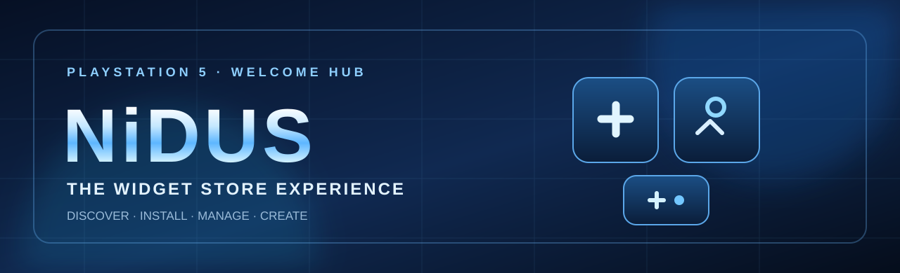
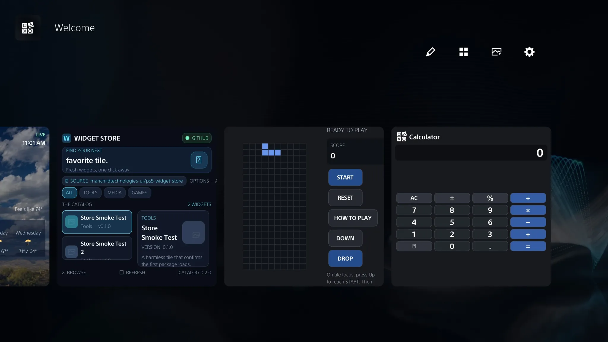

<div align="center">



# NiDUS

### Turn your PS5 Welcome Hub into something more.

**One ELF. A whole world of widgets.**

Browse, install, update, and manage community widgets — right from your console. **The NiDUS ELF installs the Widget Store for you**, so there is no separate Store installation step.

[](#before-installing)
[](#testing-and-current-status)
[](#explore-the-widgets)
[](LICENSE)

**12 widgets available now · More being added regularly · Multiple catalog sources**

[**Explore the Widget Catalog**](https://manchildtechnologies-ui.github.io/ps5-widget-store/) · [**Package Repository**](https://github.com/manchildtechnologies-ui/ps5-widget-store) · [**Installation Prerequisites**](#before-installing) · [**Developer SDK**](docs/WIDGET_SDK.md)

</div>

---

## 🎮 Meet the NiDUS Widget Store

**The Widget Store is the heart of NiDUS — and it comes included with the NiDUS ELF.** Once the ELF is successfully loaded in a supported setup, the Store is installed and ready to use without separately downloading a Store widget package. Discover games, news, weather, and utilities from a GitHub-powered catalog, inspect screenshots and package information, and install widgets directly on the PS5. NiDUS also provides the Welcome Hub loader, bridge, and SDK that make custom widgets possible.

<div align="center">


*Actual on-console Welcome Hub capture*

</div>

| **Discover** | **Install** | **Manage** |
| :--- | :--- | :--- |
| Browse widget packages, details, screenshots and full-size previews. | Download individual files, including PNG assets, with progress and installed-state indicators. | Use the Widget Manager to review installed widgets, uninstall them, and refresh the Hub. |

### 🎮 Designed for your PS5 controller

| Control | Store action |
| :---: | :--- |
| **△ Triangle** | View widget information |
| **R2** | Install the selected widget |
| **L1 / R1** | Navigate catalog pages |
| **L1** | Go back in supported views |

The Store displays **four packages per page**, opens package pages in the PS5 browser, and lets you manage catalog sources through its settings.

## 🧩 Explore the widgets

**12 widgets in the catalog today, with more on the way.** The package catalog is maintained separately from this loader repository, so the library can keep growing without bundling every widget into the framework.

| 🎮 Games | 📰 News & information | 🛠️ Utilities |
| :--- | :--- | :--- |
| **Blockris** — falling-block puzzle | **PS5 News** — headlines and releases | **Widget Store** — discover and install |
| **Snake** — directional controls | **Google News** — headlines and browser links | **Calculator** — on-console calculations |
| **Checkers** — play against the console | **TMZ** — photos and story browsing | |
| **FLAP!** — bird-and-pipes arcade | **Weather** — ZIP codes and five-day forecast | |
| **Memory Match** — card matching | | |
| **Mac-Pan** — maze chase | | |

**[Browse all packages and their screenshots →](https://manchildtechnologies-ui.github.io/ps5-widget-store/)**

## 📸 On-console showcase

<div align="center">
<table><tr><td width="50%"></td><td width="50%"></td></tr></table>
</div>

*More Store, Widget Manager, and individual-widget screenshots will be added as repository assets.*

## 🚀 What powers NiDUS

### Native Welcome Hub integration

- Renders community widgets inside the Welcome Hub's native frame and header.
- Passes widget configuration through `props.config` and per-widget settings through `props.settings`.
- Provides a native settings menu and persists widget settings in `.settings.json`.
- Supports controller navigation, focusable buttons, and native Hub interaction.
- Downloads widget package files individually, including PNG icons and other assets.
- Displays package previews and screenshots in the Widget Store.
- Records detailed installation failures to support troubleshooting.

## 🌐 The package catalog

The companion [GitHub Pages catalog](https://manchildtechnologies-ui.github.io/ps5-widget-store/) provides a browser-friendly preview of the widgets available through NiDUS. Its source lives in the separate [ps5-widget-store repository](https://github.com/manchildtechnologies-ui/ps5-widget-store), which hosts `catalog.json`, the widget package files, icons, and screenshots. Each widget also supports a direct detail-page link using `?widget=<catalog-id>`.

The current catalog contains **12 entries**, including the Widget Store itself. The console Store reads catalog metadata and installs individual package files; it does not require ZIP archives. The catalog currently identifies the Store as version **1.0.5** and the catalog schema as version **1.1.4**.

**Note:** The catalog website is for browsing and sharing widget information; actual console installation happens through the PS5 Widget Store tile and bridge.

## Testing and current status

The project owner reports that the loader and widgets run successfully on-console. Package installation has been verified with PNG assets included, and screenshots are available in the GitHub widget catalog. The installer guide documents an end-to-end Blockris installation with validated configuration, JavaScript, and icon assets.

**Firmware 13.60:** The project owner reports full on-console testing of NiDUS on PS5 firmware **13.60**, including the Widget Store, loader, and widgets. This is owner-verified testing, not a claim of compatibility with other firmware versions. Consult release-specific notes before installing.

## 🔄 Refresh the Welcome Hub after changes

**After installing or uninstalling a widget, refresh the Welcome Hub to see the change.** The Store may finish installing or removing a package before the Hub updates its visible tiles.

Choose whichever method is easiest:

1. **Use the built-in Refresh Hub button** in the NiDUS Widget Manager.
2. **Open any full-screen app, then back out** to return to the Welcome Hub.
3. **Reload the NiDUS ELF payload** to reload the Hub integration.

> [!TIP]
> If a newly installed widget is missing—or an uninstalled widget still appears—**refresh the Hub first** before troubleshooting the installation.

## Widget Store installation engine

The NiDUS Widget Store uses a catalog-driven package format with widget identifiers, versions, declared files, screenshots, and icons. Its installer fetches declared files, stages them on the console, and asks the bridge to validate and commit the package. It supports **Install**, **Update**, and **Reinstall** actions with per-file progress.

**Verified installation safeguards:**

- Staged packages are checked for a matching `config.json` id and a non-empty `widget.js`.
- Existing installations are backed up before the staged package is atomically moved into place; a failed commit restores the previous install.
- A verified restore clears its temporary backup, avoiding stale-backup failures on subsequent attempts.
- Unsafe filenames, symlinks, unexpected file types, and oversized packages are rejected. Current limits: **2 MiB per file, 16 files, and 8 MiB total**.
- Install endpoints bind to **127.0.0.1** and enforce rate limits.
- Binary assets (including PNG icons) are transferred using strict base64 decoding and atomic file writes.
- Installation and rejection details are logged in `wh.log` for troubleshooting.

**On-console verification:** A Blockris package was installed with its configuration, JavaScript, and PNG icon, and the resulting tile and glyph rendered. The installer guide documents the staged-file and commit checks.

**After installing, updating, or uninstalling:** Refresh the Hub using the Widget Manager's **Refresh Hub** button, by opening and exiting any full-screen app, or by reloading the NiDUS ELF payload. The Store does not automatically guarantee that the visible Hub tiles have refreshed.

### Catalogs and community repositories

The store uses a GitHub-hosted catalog, and NiDUS supports configuring **multiple catalog sources** through the Widget Store settings. Use the current Store build's settings to add or manage repository sources.

For installation diagnostics, inspect `/data/wh-widgets/wh.log` (and `wh.log.1` after a crash) and compare logged staged-byte counts with the package manifest.

## Before installing

> [!IMPORTANT]
> **Install and run [WelcomeHubActivator](https://github.com/ghost1372/WelcomeHubActivator) by [@ghost1372](https://github.com/ghost1372) first.** The PS5 Welcome Hub must be activated before NiDUS custom widgets can run.

- **Verified test firmware: PS5 13.60** (project-owner tested on-console). Other firmware versions are not confirmed by this statement.
- A PS5 with a compatible homebrew environment and a working method to load the supported bridge payload is required.
- **The NiDUS ELF includes the Widget Store.** You do not need to install the Store separately; after the ELF is successfully loaded, use the included Store to browse and install more widgets.
- The Welcome Hub must already be active. If needed, see [WelcomeHubActivator](https://github.com/ghost1372/WelcomeHubActivator) by **[@ghost1372](https://github.com/ghost1372)**.
- Follow instructions for the **specific build and firmware** you intend to use. Check the repository's current releases and build instructions for supported installation files; do not assume an upstream bridge binary includes NiDUS-specific changes.
- Avoid mixing experimental bridge builds or assuming upstream binaries include NiDUS-specific changes.

### Adding widgets

Once a compatible bridge is installed and running, place each unpacked widget in its own folder on the console:

```text
/data/wh-widgets/
  example-widget/
    config.json
    widget.js
    glyph.png       # optional
```

The folder name should match its widget id. Changes may require a fresh Welcome Hub runtime. See the [SDK getting-started guide](docs/sdk/getting-started.md) for deployment and troubleshooting.

## Build your own

NiDUS inherits a React Native-based widget SDK. Widgets use JavaScript with `React.createElement` and the SDK handle `globalThis.__wh` — **not** web HTML, CSS, or DOM APIs.

- [Widget SDK overview](docs/WIDGET_SDK.md)
- [Getting started](docs/sdk/getting-started.md)
- [API reference](docs/sdk/api.md)
- [Configuration](docs/sdk/config.md)
- [Controller input and focus](docs/sdk/input-and-focus.md)
- [Settings and persistence](docs/sdk/settings.md)
- [Troubleshooting](docs/sdk/troubleshooting.md)
- [Sample widgets](sample-widgets/)

A widget's entry file registers its component using `wh.register(Component)`. See the linked guides for verified examples, supported primitives, and the deployment workflow.

## Source layout

```text
framework/      PS5 bridge and widget loader source
docs/           Widget SDK and development documentation
sample-widgets/ Example widget projects
scripts/        Console and toolchain helper scripts
tools/          Build and packaging utilities
img/            Screenshots and documentation images
repo.json       Existing payload catalog metadata (upstream)
```

## ❤️ Credits & origins

- **[@geodox](https://github.com/geodox)** — Original [PS5 Welcome Hub Widgets](https://github.com/geodox/ps5-wh-widgets) project, bridge, SDK, and underlying framework. **NiDUS builds directly upon this work.** Thank you for sharing it and for your kindness to the community.
- **[@ghost1372](https://github.com/ghost1372)** — [WelcomeHubActivator](https://github.com/ghost1372/WelcomeHubActivator), which enables the Welcome Hub where required.
- **NiDUS contributors** — Additional widgets, adaptation, packaging, compatibility work, and ongoing community development.

NiDUS is an independent, unofficial community homebrew project. It is not affiliated with or endorsed by Sony Interactive Entertainment, PlayStation, or the original upstream maintainer.

## License

See [LICENSE](LICENSE). The original MIT license and geodox's copyright notice are retained.
