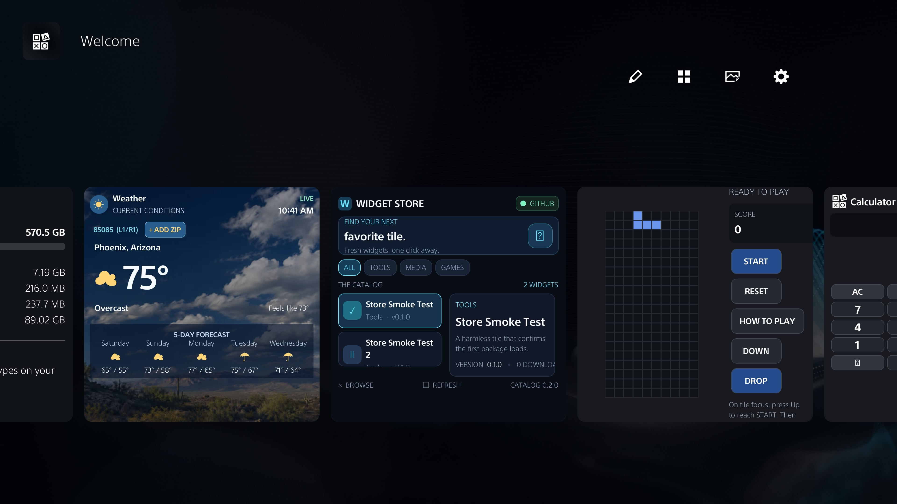

# NiDUS

**A GitHub-powered Widget Store for the PS5 Welcome Hub — browse, install, update, and manage community widgets directly on your console.**

NiDUS is a community-developed extension of the [PS5 Welcome Hub Widgets](https://github.com/geodox/ps5-wh-widgets) project by **[@geodox](https://github.com/geodox)**. It builds upon his original bridge, framework, and SDK, bringing additional widgets and compatibility work to the PS5 Welcome Hub.



> **Built on geodox's work.** A special thank-you to [@geodox](https://github.com/geodox) for creating and sharing the [original PS5 Welcome Hub Widgets project](https://github.com/geodox/ps5-wh-widgets), and for being welcoming and helpful to fellow developers. His foundation made this possible. NiDUS is an independent community fork, not an official upstream release.

## What is NiDUS?

**The Widget Store is the heart of NiDUS.** It provides a console-first way to discover community widgets from a GitHub-hosted catalog, view their previews and screenshots, and install or update them with a controller. Behind the scenes, the custom Welcome Hub loader and native bridge make these widgets available alongside the PS5's existing Hub tiles. The repository also includes developer tools, sample widgets, and SDK documentation.

## Widget Store highlights

- **Discover:** browse the GitHub-powered widget catalog with icons, package details, and screenshots.
- **Install and update:** download complete widget packages, including binary assets, with per-file progress and reinstall support.
- **Reliable installs:** validate packages, stage files, and atomically commit them with backup and restore protection.
- **Community catalogs:** the store is designed for multiple repositories; configuration and supported release details will be documented once confirmed.
- **See your widgets:** open Explore Hub after installation or update to load new or changed tiles.

## Widget Manager

The Store includes a dedicated **Widget Manager** screen for installed widgets. The on-console screenshots show an installed-widget count, a scrollable list of installed widgets with their identifiers, individual **Uninstall** actions, a **Refresh Hub** control, and a **Store** button to return to browsing. This makes removal and maintenance possible from the console interface without manually navigating the widget folders.

## Loader and platform features

- Renders community widgets inside the Welcome Hub's native frame and header.
- Passes widget configuration through `props.config` and per-widget settings through `props.settings`.
- Provides a native settings menu and persists widget settings in `.settings.json`.
- Supports controller navigation, focusable buttons, and native Hub interaction.
- Downloads widget package files individually, including PNG icons and other assets.
- Displays package previews and screenshots in the Widget Store.
- Records detailed installation failures to support troubleshooting.
- Backports the loader while reducing the bridge payload from **3.77 MB to approximately 557 KB** (project-owner reported figures; build-specific).

## Widgets in the catalog

| Category | Widgets |
| --- | --- |
| **Information & news** | Weather, PS5 News, Google News, TMZ |
| **Utilities** | Calculator |
| **Games** | Blockris, Snake, Checkers, FLAP!, Memory Match, Mac-Pan |

The repository also contains the upstream **Hello Hub** and **Payload Monitor** sample widgets.

## Testing and current status

The project owner reports that the loader and widgets run successfully on-console. Package installation has been verified with PNG assets included, and screenshots are available in the GitHub widget catalog. The installer guide documents an end-to-end Blockris installation with validated configuration, JavaScript, and icon assets.

Compatibility varies by firmware and bridge build; consult release-specific notes before installing.

## Screenshots

The existing screenshots below show the Welcome Hub integration. Additional on-console captures of the Store, Widget Manager, news widgets, games, and utilities have been supplied for the NiDUS showcase and will be added to the repository assets separately.


## Widget Store installation engine

The NiDUS Widget Store uses a catalog-driven package format with widget identifiers, versions, declared files, screenshots, and icons. Its installer fetches declared files, stages them on the console, and asks the bridge to validate and commit the package. It supports **Install**, **Update**, and **Reinstall** actions with per-file progress.

**Verified installation safeguards:**

- Staged packages are checked for a matching `config.json` id and a non-empty `widget.js`.
- Existing installations are backed up before the staged package is atomically moved into place; a failed commit restores the previous install.
- A verified restore clears its temporary backup, avoiding stale-backup failures on subsequent attempts.
- Unsafe filenames, symlinks, unexpected file types, and oversized packages are rejected. Current limits: **2 MiB per file, 16 files, and 8 MiB total**.
- Install endpoints bind to **127.0.0.1** and enforce rate limits.
- Binary assets (including PNG icons) are transferred using strict base64 decoding and atomic file writes.
- Installation and rejection details are logged in `wh.log` for troubleshooting.

**On-console verification:** A Blockris package was installed with its configuration, JavaScript, and PNG icon, and the resulting tile and glyph rendered. The installer guide documents the staged-file and commit checks.

**After installation or update:** Open **Explore Hub** to make the new or changed widget visible. The store does **not** promise an automatic refresh; signing out and back in is another documented way to refresh the Hub runtime.

### Catalogs and community repositories

The store uses a GitHub-hosted catalog, and NiDUS is being designed to accept **multiple widget repositories**. The precise multi-repository configuration and release status should be documented against the current store implementation before publishing setup steps.

For installation diagnostics, inspect `/data/wh-widgets/wh.log` (and `wh.log.1` after a crash) and compare logged staged-byte counts with the package manifest.

## Before installing

- A PS5 with a compatible homebrew environment and a working method to load the supported bridge payload is required.
- The Welcome Hub must already be active. If needed, see [WelcomeHubActivator](https://github.com/ghost1372/WelcomeHubActivator) by **[@ghost1372](https://github.com/ghost1372)**.
- Follow instructions for the **specific build and firmware** you intend to use. No NiDUS-branded release assets are currently published in this repository.
- Avoid mixing experimental bridge builds or assuming upstream binaries include NiDUS-specific changes.

### Adding widgets

Once a compatible bridge is installed and running, place each unpacked widget in its own folder on the console:

```text
/data/wh-widgets/
  example-widget/
    config.json
    widget.js
    glyph.png       # optional
```

The folder name should match its widget id. Changes may require a fresh Welcome Hub runtime. See the [SDK getting-started guide](docs/sdk/getting-started.md) for deployment and troubleshooting.

## Build your own

NiDUS inherits a React Native-based widget SDK. Widgets use JavaScript with `React.createElement` and the SDK handle `globalThis.__wh` — **not** web HTML, CSS, or DOM APIs.

- [Widget SDK overview](docs/WIDGET_SDK.md)
- [Getting started](docs/sdk/getting-started.md)
- [API reference](docs/sdk/api.md)
- [Configuration](docs/sdk/config.md)
- [Controller input and focus](docs/sdk/input-and-focus.md)
- [Settings and persistence](docs/sdk/settings.md)
- [Troubleshooting](docs/sdk/troubleshooting.md)
- [Sample widgets](sample-widgets/)

A widget's entry file registers its component using `wh.register(Component)`. See the linked guides for verified examples, supported primitives, and the deployment workflow.

## Source layout

```text
framework/      PS5 bridge and widget loader source
docs/           Widget SDK and development documentation
sample-widgets/ Example widget projects
scripts/        Console and toolchain helper scripts
tools/          Build and packaging utilities
img/            Screenshots and documentation images
repo.json       Existing payload catalog metadata (upstream)
```

## Credits & origins

- **[@geodox](https://github.com/geodox)** — Original [PS5 Welcome Hub Widgets](https://github.com/geodox/ps5-wh-widgets) project, bridge, SDK, and underlying framework. **NiDUS builds directly upon this work.** Thank you for sharing it and for your kindness to the community.
- **[@ghost1372](https://github.com/ghost1372)** — [WelcomeHubActivator](https://github.com/ghost1372/WelcomeHubActivator), which enables the Welcome Hub where required.
- **NiDUS contributors** — Additional widgets, adaptation, packaging, compatibility work, and ongoing community development.

NiDUS is an independent, unofficial community homebrew project. It is not affiliated with or endorsed by Sony Interactive Entertainment, PlayStation, or the original upstream maintainer.

## License

See [LICENSE](LICENSE). The original MIT license and geodox's copyright notice are retained.
