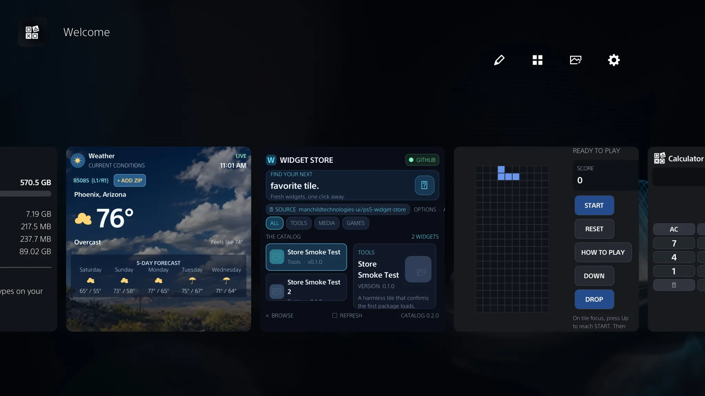

# PS5 Welcome Hub custom widgets

## WelcomeHubActivator prerequisite

The PS5 Welcome Hub must be active before custom widgets can run. If it is not already active, install and run [WelcomeHubActivator](https://github.com/ghost1372/WelcomeHubActivator) by [@ghost1372](https://github.com/ghost1372), available from the [WelcomeHubActivator Releases page](https://github.com/ghost1372/WelcomeHubActivator/releases). WelcomeHubActivator enables the Hub; this project adds custom-widget support on top of it.

A huge thank you to [@geodox](https://github.com/geodox) for the excellent original [PS5 Welcome Hub Widgets project](https://github.com/geodox/ps5-wh-widgets), its bridge and SDK, and for making this community work possible. This fork builds on that foundation.

## How this fork differs

A note from the maintainer: I’m new to GitHub and forking projects, and no ill intent was intended by anything here. If anything was done incorrectly or raises a concern, please let me know and I’ll make it right.

This community-maintained fork is developed separately from geodox's upstream project. It retains the original widget framework and adds static-bridge compatibility work plus bridge-backed Options-menu actions, including ZIP management for Weather. Firmware support is tracked for each bridge build; this is not an official upstream release.

Corrections and suggestions are welcome. If anything is inaccurate or could be improved, please open an issue; the project details and documentation can be updated.

The fork includes **Calculator**, **Tetris**, **Weather**, and **Widget Store** widgets. Calculator is a D-pad-controlled four-function calculator; Tetris is a falling-block puzzle; Weather shows current conditions and a five-day forecast with saved ZIP codes; Widget Store browses the community widget catalog.




## Welcome Hub

The Welcome Hub is a customizable panel on the PS5 home screen, added in a 2024 system software update. It shows a grid of widgets — battery, trophies, storage, friends, recently played and more — that the user can rearrange, resize and toggle from an "Edit Widgets" screen. Sony ships a fixed set of widgets; this project lets you add your own alongside them.

## Widgets

The Welcome Hub is built with **React Native**, so a widget is a **React view** — a component built from native primitives like `View`, `Text` and `Image`, not HTML/CSS. There is no DOM, no `div`, no `window`.

The SDK hands your widget everything it needs through a single handle, `globalThis.__wh`: React and the RN primitives, the Hub's stock-styled `Title`/`Label` components, icon and font helpers, and your parsed `config.json`. The framework wraps each widget in an error boundary (a bad render only breaks that tile), gives it native focus and resizing, and shows it in the Edit Widgets list with its title, icon and description.

For the full API, sizes, styling rules and stock-look components, see **[docs/WIDGET_SDK.md](docs/WIDGET_SDK.md)**.

## Upstream Sample Widgets

The upstream Hello Hub and Payload Monitor examples live in the [`sample-widgets/`](sample-widgets/) directory. You can also grab them from [Releases](../../releases).

### Hello Hub

A minimal reference widget: a live, ticking clock. It demonstrates the SDK end to end — the stock title row, stock text, an icon, hooks and a timer — and is the easiest starting point for writing a widget.

### Payload Monitor

Shows homebrew payloads currently running on the console, each with its PID and memory use, updating live. It pulls data from the [ps5-payload-manager](https://github.com/ps5-payload-dev)'s local server and filters out Sony's own system processes, so only launched payloads are shown.

## Building a Widget

A widget is a folder with a `widget.js` (the component) and a `config.json` (its metadata). No build step or bundler is needed — `widget.js` is plain JavaScript evaluated once when the Hub loads, and must be self-contained (no `import` or `require`).

**`widget.js`** — get React and the primitives from the `wh` handle, build a component with `React.createElement` (no JSX), and register it:

```js
// widget.js
(function (wh) {
  var React = wh.React;
  var View = wh.View;
  var Text = wh.Text;

  function MyWidget(props) {
    return React.createElement(
      View,
      {
        style: {
          flex: 1,
          width: 504,
          padding: 16,
          borderRadius: 16,
          backgroundColor: '#1b1d23',
        },
      },
      React.createElement(
        Text,
        { style: { color: '#ffffff', fontSize: 24 } },
        'Hello Hub'
      )
    );
  }

  wh.register(MyWidget);
})(globalThis.__wh);
```

**`config.json`** — the widget id, its name, icon and description in the Edit Widgets list, and its starting size:

```json
{
  "id": "payload-monitor",
  "title": "Payload Monitor",
  "description": "Shows running homebrew payloads",
  "glyph": "glyph.png",
  "iconId": "trophies",
  "iconFallback": "grid",
  "size": 1
}
```

Use either `glyph` for a white-on-transparent PNG in the widget folder or `iconId` for a stock IconPS glyph. The optional `iconFallback` is used if the image glyph cannot load. Sizes are 1 (default), 2 (large), or 3 (full).

**File structure** — place the widget folder in `/data/wh-widgets/` on the console. Each immediate subfolder is one widget, named by its id:

```text
/data/wh-widgets/
  payload-monitor/
    widget.js        # required component module
    config.json      # required id, title, and size
    icon.png         # optional Edit Widgets list icon
    README.md        # optional, ignored by the loader
```

Full authoring guide, including styling, sizes, icons and stock-look components: **[docs/WIDGET_SDK.md](docs/WIDGET_SDK.md)**.
